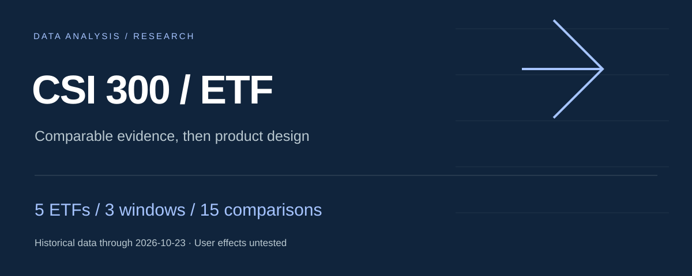

# 沪深300ETF产品比较与基金筛选工具优化

[English](README.md) · **简体中文**



比较五只跟踪同一指数的ETF，在共同窗口内核查费用、收益风险、跟踪表现与交易活跃度，再将分析证据转成可交互的筛选和并列比较工具。

[中文案例](reports/case-study.zh-CN.md) · [English case study](reports/case-study.en.md) · [9页报告](reports/report.pdf) · [离线比较工具](app/comparison-tool.html)

> GitHub 的 HTML 文件预览显示源码。体验功能请下载工具后用浏览器打开。报告正文和原工具使用中文，案例与摘要同时提供英文版本。

## 问题与发现

- 五只候选已核管理费与托管费均合计为 **0.20%/年**，但主窗口日成交额中位数最大与最小相差约 **231倍**。费率一致不能代替其他维度比较，持续费用也不等于全部交易成本。
- 在预设 **12、6、3个月**窗口中，年化事后跟踪误差的最低观察值分别出现在 **510330、510310、510300**。比较窗口应在界面里显式显示并联动，不应挑选对某只基金最有利的区间。
- 忽略分红、把单位净值变化当作总回报，会使510310在主窗口的回报观察顺序从正确第 **2**变为错误第 **4**。错误口径仅用于诊断对照。
- 在披露的报价舍入情景下，三个窗口共30对绝对收盘折溢价P95比较中，有 **9对**的条件精度范围重叠；这些边界不是统计置信区间。

## 研究范围与来源

候选：**510300、510310、510320、510330、510350**，均为沪市上市、人民币计价的沪深300ETF。这是已选候选集合，不代表全市场。

主窗口：**2025-10-24至2026-10-23**，前置基准日2025-10-23。三个窗口日收益数量分别为 **242、121、60**，采用共同日期比较。

来源包括上交所日行情、东方财富65页历史净值、中证指数价格/全收益序列及已核管理人公告。行情与净值各 **1,215行**，指数 **486行**；保留 **3次分红、10条费用生效区间**。研究参照采用 **H00300全收益指数**，不评价合同跟踪条款是否达标。

## 从分析到产品

1. **同窗口筛选与并列比较：** 按独立指标筛选，选择2—3只产品；切换观察窗口后，表格、图表基点和日期同步变化。
2. **解释与来源就近可查：** 同步展示指标定义、报价精度、缺失状态与快照日期，不生成任意加权的“最佳ETF总分”。

原型完成 **24项开发功能检查和2项来源菜单检查**。**真实参与者为0，真实用户效果尚未验证。** 已有任务、事件字典与后续评估设计，不能据此声称正确率、耗时或转化改善。

## 如何复算

使用 Python 3.10或更新版本，仅需标准库，无需账号、密钥、网络或额外包。进入本仓库文件夹后执行：

```text
python scripts/reproduce.py
```

脚本从仓库内来源事实快照重新计算 **15个产品窗口 × 8项指标，共120个指标值**：总回报、年化波动、最大回撤、相对全收益指数的跟踪误差、成交额均值/中位数/P10、绝对收盘折溢价P95，并与发布的CSV核对。数据库仅作为只读输入；成功输出 `"passed": true`。

该复算从随仓库提供的结构化快照开始，不是重新下载全部原始响应。完整历史来源仍保留在研究归档中。

## 文件结构

| 路径 | 内容 |
| --- | --- |
| `reports/` | 中文报告与英文摘要 |
| `app/` | 可离线打开的比较工具 |
| `sql/` | 模型、质量、关联、财富路径与跟踪查询 |
| `data/` | 来源数据库、输入、正式结果与稳健性表 |
| `scripts/reproduce.py` | 来源事实独立复算及对照 |
| `SOURCE-NOTES.md` | 快照范围与数据库校验值 |

## 解释边界

历史比较不预测未来收益；成交额不是买卖价差或执行成本；收盘价与净值的偏离不是盘中可执行套利收益。缺少历史份额、盘口和真实用户日志，相应结论不推断。已知持续费用已反映在净值中，不重复扣减。
